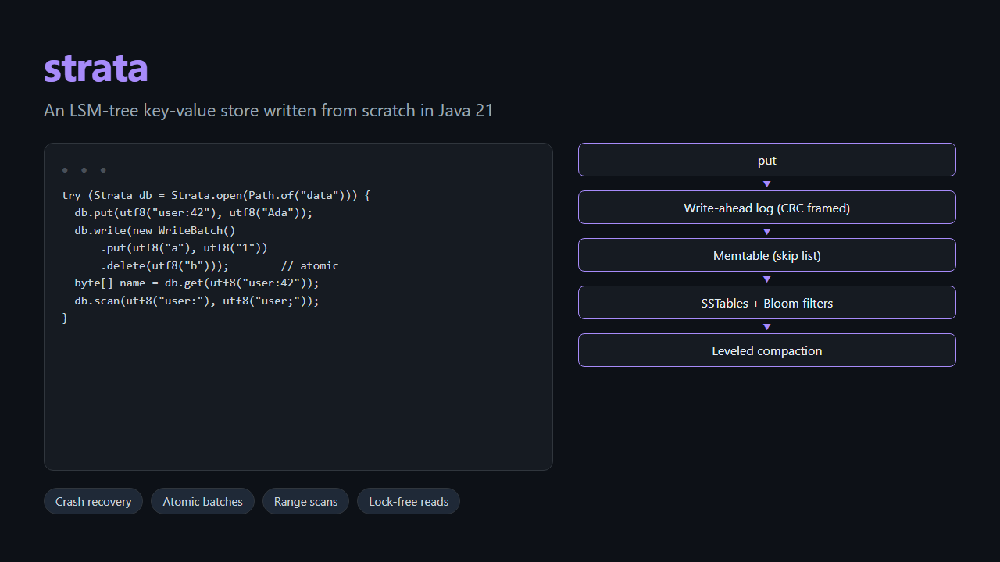

# Strata

**An LSM-tree key-value store written from scratch in Java 21**: the storage design behind LevelDB, RocksDB and Cassandra. It has a write-ahead log, memtables, SSTables with Bloom filters, leveled compaction and crash recovery. It is tested against a reference model and by killing the writing process for real.

<p align="center">
  
</p>

[](https://github.com/Tendo505/strata/actions/workflows/ci.yml)

```java
import static io.github.tendo505.strata.util.Bytes.*; // utf8(), string()

try (Strata db = Strata.open(Path.of("data"))) {
    db.put(utf8("user:42"), utf8("Ada"));
    db.write(new WriteBatch().put(utf8("a"), utf8("1")).delete(utf8("b"))); // atomic
    byte[] name = db.get(utf8("user:42"));
    try (Strata.Scan scan = db.scan(utf8("user:"), utf8("user;"))) {   // a key range, in order
        scan.forEachRemaining(e -> System.out.println(string(e.key())));
    }
}
```

## How it works

```
 put ──► write-ahead log (CRC-framed records) ──► memtable (concurrent skip list)
                                                     │ full (4 MiB)
                                                     ▼
                                               immutable memtable ──flush thread──► L0 table
                                                                                      │
                                              compaction thread: merge into the next level
                                                                                      ▼
 get ──► memtable ─► immutable ─► L0 (newest first) ─► L1 ─► L2 ─► …   (each level 10× bigger)
```

* **Writes** append one checksummed record to the WAL, then go into a skip list. A write batch is one record, so it's atomic. Writes never touch SSTables, so random writes become sequential I/O.
* **SSTables** are immutable sorted files: 4 KiB data blocks (each with a CRC32C), a Bloom filter (10 bits per key, measured 0.94% false positives), a block index and a fixed footer. A lookup reads at most one block, and the Bloom filter usually rules a table out without reading any.
* **Leveled compaction**: level 0 tables may overlap; every deeper level is one sorted run of non-overlapping tables, ten times larger than the one above. Compactions merge a table into the overlapping range of the next level (a k-way heap merge, newest version wins). Tombstones are dropped only when no deeper level could still hold an older value. A table with nothing to merge with is moved down without being rewritten (a "trivial move").
* **Flushes have their own thread**, as in RocksDB, so a long compaction never leaves a full memtable, and the writers behind it, waiting. Writers stall only if level 0 piles up past 12 tables, or a second memtable fills before the first is on disk.
* **The manifest** is a log of version edits (tables added and removed). `CURRENT` names the live manifest and is replaced atomically (temp file, fsync, rename).
* **Readers never block**: gets and scans pin a reference-counted *version* (the set of live tables), so compaction can replace tables while a scan is still reading the old ones. Files are deleted when the last version that lists them is released.
* **Recovery** replays the WAL from the point the manifest says is already in tables, stops cleanly at a torn final record, flushes, and deletes half-written leftovers from an interrupted flush or compaction.

Every step that must survive a crash happens in an order that makes it safe. A table is fully written and fsynced, then the manifest edit that lists it is fsynced, and only then is the WAL it replaces deleted. A crash between any two steps leaves either the old state or the new one.

## Testing

| Test | What it checks |
| --- | --- |
| **Model-based** (8 seeds × 12,000 ops) | Random puts, deletes, batches, gets and range scans run against Strata and a `TreeMap`, and every read must agree. Tiny options mean each seed goes through ~20 reopens and ~100 compactions, with data reaching level 3. Structural invariants (sorted, non-overlapping levels) are checked throughout |
| **Real crashes** | A child JVM writes as fast as it can and prints each write's number once `put` returns. The test kills it (`SIGKILL` / `TerminateProcess`) at random moments, 6 times on the same database, with and without fsync. The reopened database must contain exactly the acknowledged writes, plus at most the one in flight |
| **Torn WAL** | A log is cut at *every* byte offset; recovery must return exactly the complete records. A flipped bit mid-file is caught by the checksum |
| **Corruption** | A flipped byte in an SSTable block makes reads of that block fail with a checksum error instead of returning garbage. Other blocks still work |
| **Concurrency** | One writer, four readers and two full-table scanners for 3 s while flushes and compactions run: ~6 million reads, and no counter is ever seen going backwards and no scan is out of order |
| **Pinned versions** | A scan opened before the whole database is rewritten and compacted still reads its original tables to the end |

```bash
./gradlew test
```

## Performance

`strata bench`, modelled on LevelDB's `db_bench`: 1,000,000 keys of 16 bytes, values of 100 random bytes, default options, one thread. Measured on an AMD Ryzen 7 7435HS laptop with an NVMe SSD, Windows 11, JDK 25:

| workload | ops/s | MB/s | notes |
| --- | ---: | ---: | --- |
| fillseq | 193,129 | 22.4 | sequential keys |
| fillrandom | 56,413 | 6.5 | random order, timed until compaction reaches a steady shape |
| readrandom | 130,633 | 15.2 | p50 7.2 µs, p99 19.6 µs |
| readmissing | 2,304,785 | 267.4 | p50 0.3 µs: Bloom filters skip almost every table |
| seekrandom + 100 next | 20,907 | 2.4 | range scans of 100 entries |
| overwrite | 46,358 | 5.4 | every key again, random order |

After `fillrandom` the tree is L1 8 MiB, L2 99 MiB, L3 8 MiB in 57 tables, with a **write amplification of 5.6**: each byte written by the user was written to SSTables 5.6 times by flushes and compactions. Random loading is limited by compaction speed. With fsync on every write, throughput drops to about 500 writes/s on this machine, the cost of one `FlushFileBuffers` per write (see *group commit* below).

CI reruns the benchmark at 200,000 keys on every push.

## Command line

```bash
./gradlew installDist
build/install/strata/bin/strata put data hello world
build/install/strata/bin/strata get data hello
build/install/strata/bin/strata scan data [from] [to]
build/install/strata/bin/strata stats data
build/install/strata/bin/strata compact data
build/install/strata/bin/strata bench 1000000 [--sync]
```

## Layout

```
Strata.java        the database: write path, reads, scans, flush and compaction threads, versions, recovery
MemTable.java      skip-list memtable with tombstones
MergingCursor.java k-way merge, newest source wins
Version*.java      immutable sets of tables per level, and the edits between them
Manifest.java      the version log and the atomic CURRENT pointer
wal/               checksummed record log (WAL and manifest), torn-tail-tolerant reader
sstable/           table writer and reader, Bloom filter, LRU block cache
```

About 2,000 lines of Java 21, with no dependencies outside JUnit. It compiles with `-Xlint:all -Werror`.

## Not implemented (yet)

* **Group commit**: concurrent writers could share one fsync, the standard fix for slow synced writes.
* **Snapshots / MVCC**: scans pin the set of tables, but see memtable writes made during the scan. Sequence numbers would give point-in-time snapshots.
* **Compression** of data blocks, and **prefix compression** of keys within a block.
* Parallel compactions, and sub-compactions of large key ranges.

MIT License
